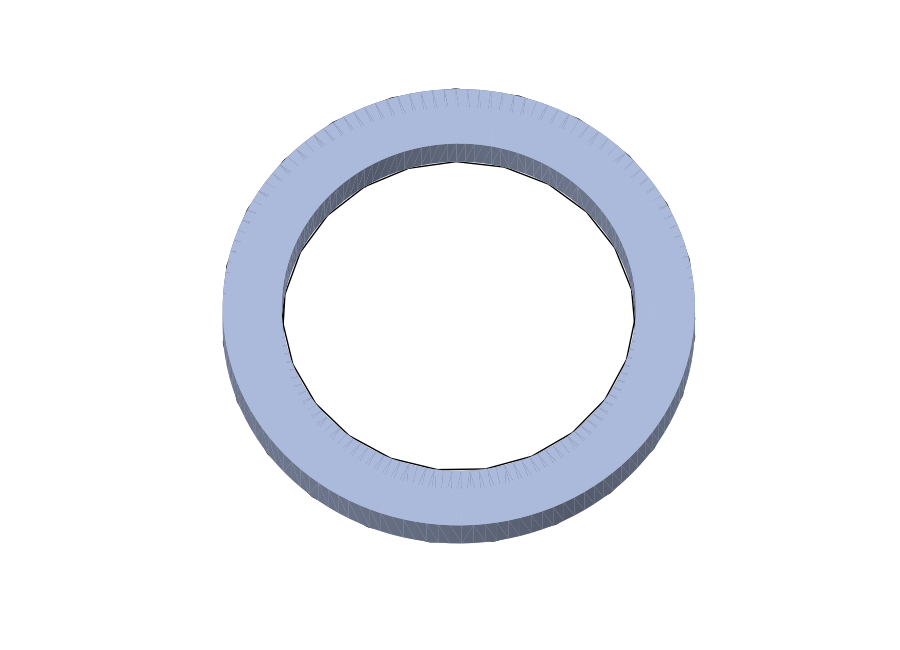

# agentic-cad-workflow

[](https://github.com/gitfish256/agentic-cad-workflow/actions/workflows/tests.yml)

[](LICENSE)

An agent-neutral CAD runtime and portable workflow for turning natural-language
physical-object prompts into measured, rendered, heuristically validated
STL/STEP/BREP model files.

The host agent (Codex, Claude Code, Hermes, or another coding agent) interprets
the prompt and writes or revises CadQuery code. This package executes that code
locally, exports print/model artifacts, measures the geometry, renders previews,
and reports machine-readable validation. It contains no LLM provider and does
not use MCP sampling.

Powered by [CadQuery](https://cadquery.readthedocs.io/); not affiliated with,
sponsored by, or endorsed by the CadQuery project.



## Architecture

```text
user prompt
    -> host agent writes CadQuery
    -> execute_cadquery (MCP) or agentic-cad-build (CLI)
    -> isolated execution + STL/STEP/BREP export
    -> geometry measurements + validation + shaded previews
    -> host agent accepts or revises the code and repeats
```

The workflow is intentionally split into three layers:

- **Agent-neutral runtime:** stdio MCP server, code-build CLI, artifact tools.
- **Portable workflow:** `agent-workflows/agentic-cad-workflow.md` defines the
  code contract, evidence loop, validation profiles, and handoff rules.
- **Thin adapters:** `AGENTS.md`, `CLAUDE.md`, and the bundled Hermes skill teach
  each host how to load the same workflow.

## Supported integration paths

| Host | Prompt reasoning | Runtime connection | Workflow adapter |
| --- | --- | --- | --- |
| Codex | Codex authors/refines code | stdio MCP | `AGENTS.md` + server instructions |
| Claude Code | Claude authors/refines code | stdio MCP | `CLAUDE.md` + server instructions |
| Hermes | Hermes authors/refines code | stdio MCP | bundled Hermes skill + server instructions |
| Other MCP agent | Host authors/refines code | stdio MCP | portable workflow + server instructions |
| Agent without MCP | Host authors/refines a `.py` file | `agentic-cad-build` | portable workflow |

## Prerequisites

Python 3.10-3.14 is supported. Clone or download this repository before running
the commands below. Linux also needs the OpenGL runtime used by CadQuery/OCP:

```bash
sudo apt-get update
sudo apt-get install -y libgl1
```

## Windows installation

For normal use from a source checkout, create an isolated environment and
install the package without development-only tools. From PowerShell:

```powershell
py -3.12 -m venv .venv
.\.venv\Scripts\python.exe -m pip install --upgrade pip
.\.venv\Scripts\python.exe -m pip install .

# Deterministic runtime smoke test using agent-authored example code
.\.venv\Scripts\agentic-cad-build.exe .\examples\ring_brim.py `
  --prompt "ring brim, 120mm OD, 90mm ID, 12mm tall" `
  --output-dir .\outputs --style shaded
```

The command prints JSON. Exit code 0 means execution and geometry validation
succeeded; 1 means execution/export failed; 2 means artifacts were produced but
validation failed.

## macOS/Linux installation

```bash
python3.12 -m venv .venv
./.venv/bin/python -m pip install --upgrade pip
./.venv/bin/python -m pip install .

./.venv/bin/agentic-cad-build examples/ring_brim.py \
  --prompt "ring brim, 120mm OD, 90mm ID, 12mm tall" \
  --output-dir outputs --style shaded
```

Artifacts are written under `outputs/<run-id>/`. The `outputs/` directory is
ignored by git.

## Development installation

Contributors should use an editable install with the test and release tools:

```powershell
# Windows PowerShell
.\.venv\Scripts\python.exe -m pip install -e ".[dev]"
```

```bash
# macOS/Linux
./.venv/bin/python -m pip install -e ".[dev]"
```

See [CONTRIBUTING.md](CONTRIBUTING.md) for repository checks and contribution
boundaries.

## Codex setup and use

Codex CLI, the IDE extension, and the desktop app share MCP configuration. Use a
local absolute executable path so no machine-specific config is committed.

Windows PowerShell:

```powershell
$server = (Resolve-Path .\.venv\Scripts\agentic-cad-mcp.exe).Path
$outputs = Join-Path (Get-Location) "outputs"
codex mcp add agentic_cad -- $server --output-dir $outputs
codex mcp list
```

macOS/Linux:

```bash
server="$(pwd)/.venv/bin/agentic-cad-mcp"
outputs="$(pwd)/outputs"
codex mcp add agentic_cad -- "$server" --output-dir "$outputs"
codex mcp list
```

Restart the Codex client after registration and open this repository so
`AGENTS.md` is loaded. A suitable request is:

```text
Read the portable agentic CAD workflow. Design a ring-shaped cat-bed brim with
120mm outer diameter, 90mm inner diameter, and 12mm height. Author the CadQuery
code yourself, call execute_cadquery with shaded previews, check actual geometry,
and report the final STL and STEP paths.
```

Codex should author the code and call `execute_cadquery`; there is no
server-side `generate_model` or `refine_model` tool.

## Claude Code setup and use

`CLAUDE.md` imports the portable workflow. Register the same local server.

macOS/Linux:

```bash
claude mcp add --scope local --transport stdio agentic_cad -- \
  "$(pwd)/.venv/bin/agentic-cad-mcp" --output-dir "$(pwd)/outputs"
claude mcp get agentic_cad
```

Windows PowerShell:

```powershell
$server = (Resolve-Path .\.venv\Scripts\agentic-cad-mcp.exe).Path
$outputs = Join-Path (Get-Location) "outputs"
claude mcp add --scope local --transport stdio agentic_cad -- $server --output-dir $outputs
claude mcp get agentic_cad
```

Start Claude Code from the repository and use `/memory` to confirm that
`CLAUDE.md` loaded. Ask Claude to write the CadQuery itself, call
`execute_cadquery`, inspect the returned dimensions and previews, and revise its
code when needed.

## Hermes setup and use

Install the bundled thin adapter:

```powershell
.\.venv\Scripts\agentic-cad-install-hermes-skill.exe
```

```bash
./.venv/bin/agentic-cad-install-hermes-skill
```

The installer copies `SKILL.md` to
`~/.hermes/skills/creative/agentic-cad-workflow/SKILL.md` and prints a
cross-platform MCP config snippet. Hermes follows the same Agent-driven loop:
it authors code, calls `execute_cadquery`, judges evidence, and revises code.

## Agent without MCP

An installed wheel exposes the same canonical guide used by repository-aware
agents:

```bash
agentic-cad-build --print-workflow
```

An agent with shell access can write a CadQuery source file and run:

```bash
agentic-cad-build model.py \
  --prompt "the original physical-object prompt" \
  --output-dir outputs \
  --bed-size 220 \
  --validation-profile printable \
  --style shaded \
  --execution-timeout 60
```

Pass `-` as the source to read code from stdin. The CLI uses the same worker,
validation, preview, and export implementation as MCP.

## Agent-authored CadQuery contract

Code submitted to the runtime should:

- work in millimeters and import `cadquery as cq`;
- assign one final model to `result` and call `show_object(result, name=...)`;
- complete intended booleans rather than emit unrelated shapes;
- place printable geometry on or above Z=0, normally base-on-Z=0;
- avoid network access, subprocesses, and writes outside the output directory.

See [ring_brim.py](examples/ring_brim.py) and
[door_stopper.py](examples/door_stopper.py) for ordinary code examples, not
hard-coded prompt fallbacks.

## MCP tools

| Tool | Purpose |
| --- | --- |
| `execute_cadquery` | Primary build: execute agent-authored code, export STL/STEP/BREP/SVG/PNG, measure, and validate. |
| `inspect_cadquery` | Execute code and return properties/validation without exporting files. |
| `render_preview` | Execute code and produce preview artifacts. |
| `inspect_artifact` | Inspect saved STEP/STP/BREP/BIN geometry. STL returns guidance to use its exact-format sibling. |
| `render_artifact` | Render saved exact geometry from standard views. |
| `make_radial_assembly` | Rotate segment copies into a compound or fused full reference. |
| `split_artifact` | Split oversize exact geometry into printable, recentered planar-cut segments. |

The server's MCP initialization instructions contain the short cross-tool loop,
so an MCP host can use the runtime even when it has not opened this repository.

## Efficient result handling

Code-building tools default to `verbosity: normal`, which omits the code the host
agent already owns. Available controls are:

- `summary`: compact result and validation summary.
- `normal`: default; measurements, paths, checks, and compact metadata without
  repeated code.
- `full`: complete payload including submitted code.
- `include_code` and `include_metadata`: explicit overrides.

Pass `include_images: false` when image attachments are unnecessary; preview
paths remain in JSON.

## Validation profiles and limitations

- `printable`: BREP validity, solid/positive volume, overall bounding-box bed fit,
  and base at Z=0 are enforced.
- `reference`: intended for full-size master geometry; size/base are advisories.
- `assembly`: intended for compounds; size/base are advisories.

`bed_size` is currently one conservative maximum applied to all three bounding-
box axes (X, Y, and Z). It is not a separate X/Y build plate plus Z build
height; use the smallest relevant machine limit or review the dimensions
manually when your printer has different axis limits.

Validation reports use `scope: geometry_heuristic`. They do not prove prompt
conformance or automatically measure local wall thickness, holes/clearances,
overhangs, supports, material behavior, strength, or STL manifoldness. The host
agent must compare actual dimensions and shaded previews with the prompt, and a
slicer/material review is required before manufacturing.

## Generated-code security

CadQuery code executes in a disposable subprocess with a reduced environment and
a default 60-second timeout. This reduces the impact of a direct worker crash or
loop, but it is not an OS sandbox or a memory, disk, subprocess-tree, or network
limit: generated Python retains the current user's permissions. Existing
STEP/BREP files are also parsed by the local process and must be trusted. Keep
the server local and use a container, VM, or restricted OS account for stronger
isolation. See [SECURITY.md](SECURITY.md).

## Run data and privacy

Every build creates a run directory and saves the complete original prompt as
`prompt.txt`, the submitted CadQuery source as `model.py`, and the full result as
`metadata.json`, including resolved absolute artifact and output paths. These
files are useful for reproducibility and refinement, but prompts and code may
contain private product details, unreleased designs, or other sensitive data.

The repository's default `outputs/` directory is ignored by git. A custom output
directory outside this checkout is not protected by this `.gitignore`. Review
and remove sensitive run directories before sharing logs, archives, screenshots,
or model bundles, and never force-add `outputs/` to version control. Do not put
credentials or secrets in a model prompt or generated CadQuery code.

## Development and release checks

Windows:

```powershell
.\.venv\Scripts\python.exe -m ruff check .
.\.venv\Scripts\python.exe -m ruff format --check .
.\.venv\Scripts\python.exe -m pytest -q
.\.venv\Scripts\python.exe -m compileall -q src tests
.\.venv\Scripts\python.exe -m pip check
.\.venv\Scripts\python.exe -m build
.\.venv\Scripts\python.exe -m twine check dist\*
```

macOS/Linux:

```bash
./.venv/bin/python -m ruff check .
./.venv/bin/python -m ruff format --check .
./.venv/bin/python -m pytest -q
./.venv/bin/python -m compileall -q src tests
./.venv/bin/python -m pip check
./.venv/bin/python -m build
./.venv/bin/python -m twine check dist/*
```

CI runs lint/format checks, exercises Python 3.10-3.14, and tests Windows,
macOS, and Ubuntu. It then builds the wheel once and performs real CLI and MCP
builds from clean Python 3.14 wheel installs on all three operating systems.

## License

MIT. See [LICENSE](LICENSE).
